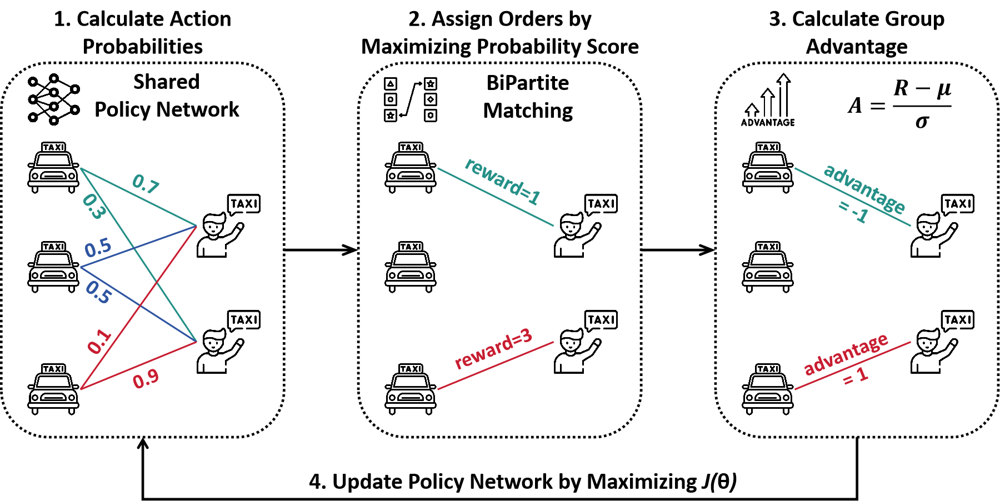

# Scale-OSPO

**Article:** Zijian Zhao, Sen Li*, "Scale-OSPO: Efficient Order Dispatch on Ride-Sharing Platform via One-Step Policy Optimization and Single Parameter Tuning" (under way)

Expanded version of [RS2002/Scale-OSPO: Official Repository for The Paper, Scale-OSPO: Efficient Order Dispatch on Ride-Sharing Platform via One-Step Policy Optimization and Single Parameter Tuning](https://github.com/RS2002/Scale-OSPO).

## 1. Workflow




## 2. Simulator

Please refer to [RS2002/Scale-OSPO: Official Repository for The Paper, Scale-OSPO: Efficient Order Dispatch on Ride-Sharing Platform via One-Step Policy Optimization and Single Parameter Tuning](https://github.com/RS2002/Scale-OSPO).


## 3. How to Run

### 3.1 Pre-train

Execute the following command in the `./OSPO/pretrain` directory:

```
python train.py
```


### 3.2 Fine-tune

Execute the following command in the `./OSPO/finetune` directory:

```
python train.py --model_path <path_to_trained_model_from_pretraining>
```


## 4. Reference

```

```

