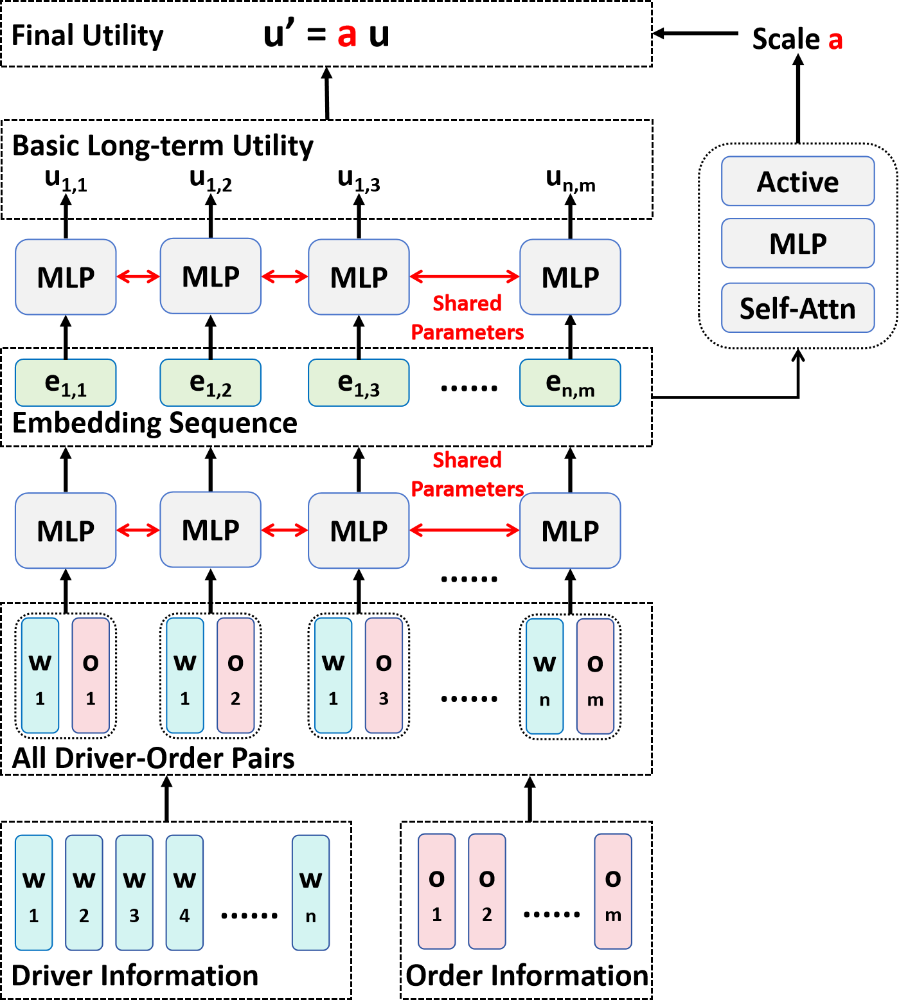

# Scale-OSPO

**Article:** Zijian Zhao, Sen Li*, "OSPO: One-Step Policy Optimization for Real-Time Order Assignment on Ride-Sharing Platforms with Autonomous Vehicles" (under review)


## 1. Workflow





## 2. Simulator

Please refer to [RS2002/OSPO: Official Repository for The Paper, One Step is Enough: Multi-Agent Reinforcement Learning based on One-Step Policy Optimization for Order Dispatch on Ride-Sharing Platforms](https://github.com/RS2002/OSPO).


## 3. How to Run

### 3.1 Pre-train

Execute the following command in the `./OSPO/pretrain` directory:

```
python train.py
```


### 3.2 Fine-tune

Execute the following command in the `./OSPO/finetune` directory:

```
python train.py --model_path <path_to_trained_model_from_pretraining>
```


## 4. Reference

```

```

